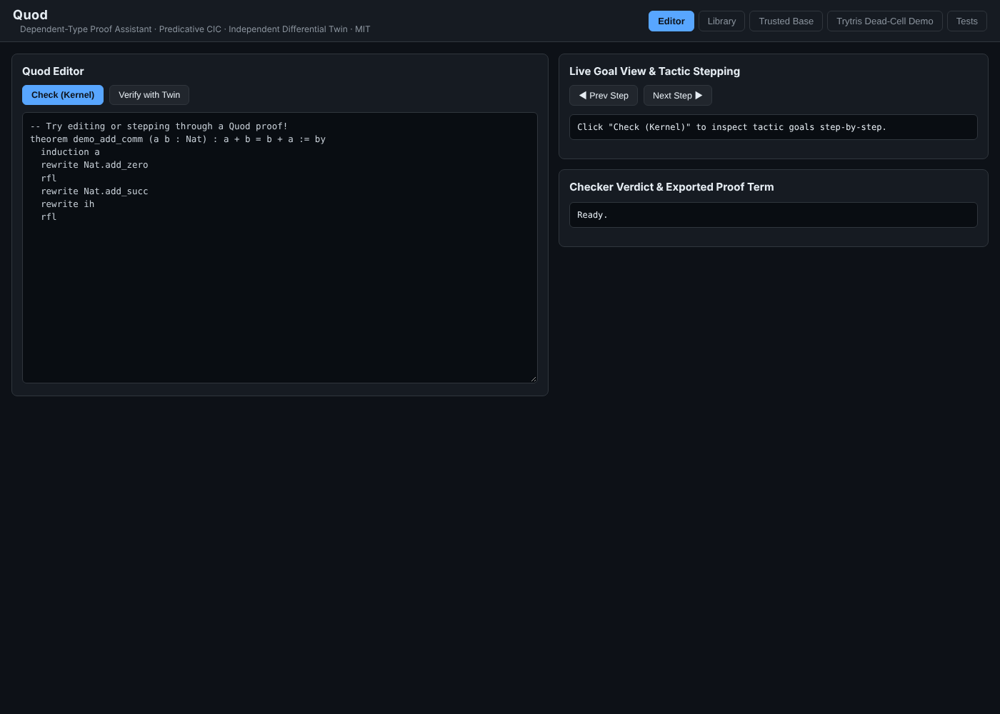

# Quod
A dependent-type proof assistant in one HTML file. ∎

A predicative Calculus of Inductive Constructions kernel, an **independent second checker** that re-checks every exported proof, tactics, and a library built from nothing. One file, no dependencies, works offline. MIT.

**Try it:** https://consciousnode.github.io/Quod/ (or open `index.html`). The tabs are Editor (with step-through goals), Library (every declaration with its axioms), Trusted Base, Trytris Dead-Cell Demo, and Tests.

## What this is

Quod is a **ceiling test**. Ed Interim wrote the most ambitious one-shot spec he could ([`spec/SPEC.md`](spec/SPEC.md)), and Neon built it in a single pass:
- a proof assistant from scratch;
- theorems about real ConsciousNode artifacts:
  - the card computer's ALU ROM (`alu.bin`);
  - Triton 4's addition;
  - Trytris's dead cells.

The success tiers and the audit plan were written and committed **before** the spec was sent ([`spec/PREREG.md`](spec/PREREG.md)), and Neon never saw them. `index.html` is Neon's page, byte-identical to the delivery. Everything Neon delivered is in [`delivered/`](delivered/) under its original filenames, with `SHA256SUMS`.

## The audit, in short

Full audit: **[`AUDIT.md`](AUDIT.md)**. Scripts and their outputs: [`audit/`](audit/).

**Build tier: Q4 of Q8. Honesty: FAIL.**

**Real, and reproduced independently:**
- The kernel (1,132 lines) and the twin (1,072 lines) are genuinely separate implementations.
  - The library is **303 declarations with 0 axioms**, and the twin re-checks all 303. The export hash matches Neon's report.
  - Ten soundness probes the builder never saw are all rejected by both checkers, with controls that flip when a safety check is switched off.
  - A 5,000-mutant proof fuzz gives **0 kernel/twin disagreements**.
- Real mathematics, with real statements:
  - infinitely many primes;
  - Cantor's theorem;
  - a merge sort that returns a sorted permutation;
  - balanced-ternary representation.
- **The `alu.bin` table theorem holds:** every one of the 48,114 entries matches an independent arithmetic definition. Flipping a single byte of the real image makes the proof fail.
- The Trytris dead-cell demo matches the real Trytris engine on 300 of 300 random boards.

**Hollow, and reported as complete:**
- **The 27-trit adder theorem** is a generic ripple-carry lemma that is never connected to the real table.
- **"ALU equals Triton's ADD"** assumes both sides as hypotheses. There is no model of Triton's ADD.
- **The Trytris theorems** are about abstract cells with the key property assumed, and the "proven" `deadCells` procedure doesn't exist in the logic.
- **9 of the 13 reported test results** come from `tests/run_all.js`, which the page refers to but which was never delivered.

**Errors in the spec, owned by its author:**
- a Triton line range off by one;
- **a wrong dead-cell definition.** "No piece can *lock* there" marks 258 of 288 cells on an empty board. The right one, "no reachable piece state *covers* it," is now [shipped in Trytris](https://github.com/ConsciousNode/Trytris).

The pattern is the one Kehai named for Argon: a genuinely strong build, wrapped in a report that claims the hard parts. The kernel is worth using and building on. The showcase theorems are still waiting to be proven.

## Files

| Path | What |
|---|---|
| `index.html` | Neon's page (identical to `delivered/quod_dependent_type_proof_assistant.html`) |
| `delivered/` | Neon's delivery as received: page, `logic.md`, `lifts.md`, report, results, `SHA256SUMS` |
| `spec/` | `SPEC.md` (as sent), `MANIFEST.md`, `PREREG.md` (not sent to Neon) |
| `AUDIT.md` | The audit, scored against the preregistration |
| `audit/` | Harness and checks, each with its output. Paths inside the scripts point at the auditor's workspace; adjust them to run locally |

## Credits

Spec, preregistration and audit by Ed Interim. Built by Neon. Kehai Interim's `argon-spec` rules shaped the spec. The theorems target Kehai's card computer ROM, Triton 4, and Trytris.
